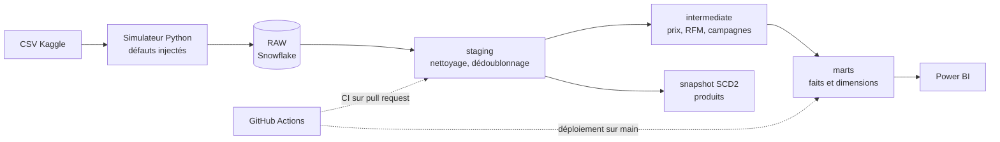

# Retail Marketing Analytics — dbt + Snowflake

Pipeline analytique de bout en bout sur deux ans de tickets de caisse d'une chaîne de
supermarchés : ingestion simulée avec des défauts réalistes, modélisation dbt en couches,
plus de 160 tests de qualité, intégration continue, et trois questions métier traitées
jusqu'au chiffre.

**Stack** : Snowflake · dbt Core 1.12 · dbt_utils · dbt_expectations · Python · GitHub Actions · Power BI

---

## Le problème

Les données de commerce n'arrivent jamais propres. Un même ticket est envoyé deux fois,
une caisse transmet sa semaine avec trois semaines de retard, un produit change de
catégorie sans que l'historique suive. Un pipeline qui marche sur un export figé peut
donner des chiffres faux dès que les données arrivent en flux.

Ce projet part donc d'un jeu de données statique (dunnhumby *The Complete Journey* :
2 500 foyers, 102 semaines, 2,6 millions de lignes) et le **rejoue semaine par semaine**,
en y injectant volontairement ces défauts. Chaque défaut injecté est journalisé, ce qui
permet de **prouver**, test à l'appui, que le pipeline les traite tous.

## Les questions métier et ce qu'on en tire

### 1. Quelles campagnes génèrent réellement des ventes supplémentaires ?

Comparer les foyers ciblés avant et pendant une campagne ne suffit pas : la saison et la
tendance touchent tout le monde. L'effet est donc mesuré par **différence de différences**
contre un groupe témoin de foyers ciblés par aucune campagne au même moment.

Le point délicat : le magasin cible ses meilleurs clients (9 € par jour avant campagne,
contre 3 € pour les témoins). Comparés directement, **11 campagnes sur 25 ressortaient
négatives**, un résultat incohérent pour des campagnes qui distribuent des bons de
réduction. La cause est la **régression vers la moyenne** : un foyer sélectionné à un pic
de dépense redescend ensuite, campagne ou non. En comparant les foyers **à dépense égale
avant campagne** (5 tranches, effet moyen pondéré par les foyers ciblés), une seule
campagne reste négative, et elle ne cible que 17 foyers.

| Campagne | Foyers ciblés | Effet par foyer et par jour | Intervalle à 95 % | Ventes supplémentaires |
|---|---|---|---|---|
| 13 (TypeA) | 1 060 | +1,28 € (+17 %) | 0,76 → 1,80 € | 65 200 € |
| 18 (TypeA) | 1 114 | +0,90 € (+12 %) | 0,31 → 1,50 € | 56 300 € |
| 8 (TypeA)  | 1 060 | +0,76 € (+10 %) | 0,24 → 1,29 € | 39 600 € |

Sur les 25 campagnes mesurables, **14 ont un effet démontré** (intervalle de confiance
qui exclut zéro), pour environ 270 000 € de ventes supplémentaires.

Deux enseignements au-delà du chiffre :
- **les campagnes agissent sur les clients modérés, pas sur les plus gros acheteurs** :
  dans la tranche des 20 % qui dépensent le plus, l'effet est nul, sur les campagnes 8
  et 13 ;
- **la plupart des campagnes sont trop petites pour prouver leur effet** : avec un effet
  typique d'environ 1 € par jour, il faut de l'ordre de 600 foyers ciblés pour le
  démontrer, quand beaucoup de campagnes en ciblent 100 à 200.

### 2. Quels segments clients ont le plus de valeur, lesquels décrochent ?

Segmentation RFM (récence, fréquence, montant) sur les achats de marchandise, carburant
exclu, en une grille récence × valeur :

| Segment | Foyers | Part du CA | Absence moyenne |
|---|---|---|---|
| champions | 21 % | **50 %** | 2 jours |
| loyal | 23 % | 23 % | 3 jours |
| **at_risk** | **12 %** | **14 %** | **30 jours** |
| occasional | 16 % | 6 % | 4 jours |
| hibernating | 28 % | 7 % | 77 jours |

Un client sur cinq fait la moitié du chiffre d'affaires. Le segment **at_risk** répond à
la question « qui décroche » : des foyers de valeur, absents depuis un mois quand les
clients actifs viennent tous les 2 à 4 jours, qui portent 14 % du chiffre d'affaires.

### 3. Évolution du panier moyen et de la fréquence par profil de foyer

Les données sont prêtes (`fct_transactions`, `dim_households`, `dim_date`) ; l'analyse
est restituée dans le tableau de bord Power BI. Une précaution, documentée dans le modèle :
seuls 801 foyers sur 2 500 ont un profil démographique, et ce sont les plus actifs. Toute
analyse par âge ou par revenu ne porte que sur eux.

---

## Architecture



| Couche | Rôle | Matérialisation |
|---|---|---|
| `RAW` | Données brutes chargées par le simulateur, avec `_loaded_at` et `_batch_id` | Tables |
| staging | Une vue par table source : renommage, typage, placeholders convertis en null, dédoublonnage, lignes invalides signalées | Vues |
| intermediate | Logique partagée : mesures de prix, classification des produits, RFM, mesure d'effet des campagnes | Vues |
| marts | `fct_transactions`, `fct_campaign_performance`, `dim_households`, `dim_products`, `dim_date` | Tables, `fct_transactions` incrémental |

Les rôles Snowflake sont séparés (`LOADER` pour l'ingestion, `TRANSFORMER` pour dbt,
`REPORTER` pour le reporting) : dbt ne peut pas modifier les données brutes.

## Choix techniques

**Modèle incrémental filtré sur la date de chargement, pas sur la date d'achat.** Une
ligne de la semaine 91 livrée en semaine 94 a une date d'achat ancienne mais un
`_loaded_at` récent : seul ce second filtre la rattrape. Le `merge` sur
`(basket_id, product_id)` rend le modèle idempotent, ce qui autorise une fenêtre de
sécurité de 3 jours retraitée à chaque exécution.

**Snapshot SCD2 en stratégie `check`, pas `timestamp`.** Le catalogue est rechargé en
entier à chaque livraison : `_loaded_at` change pour tous les produits. Une stratégie
`timestamp` créerait 92 000 versions par semaine ; `check` sur les colonnes métier ne
garde que les vrais changements.

**Signaler plutôt que supprimer.** Les lignes invalides restent en staging avec un
`rejection_reason`, les remises sont passées en positif par `-1 *` et non `abs()` pour
que les anomalies de la source restent visibles aux tests.

**Une règle métier, un seul endroit.** La classification des produits (carburant, non
marchand) et les mesures de prix vivent dans des modèles intermédiaires partagés, pour
que le chiffre d'affaires du tableau de bord, la RFM et les campagnes appliquent la même
définition.

**Vérifier le sens d'une colonne sur les données.** `sales_value` est-il avant ou après
remise ? À produit, magasin et semaine égaux, `sales_value` + remise fidélité retrouve le
prix sans remise dans 67 % des cas, contre 1 % pour `sales_value` seul : c'est un montant
après les remises du magasin.

## Défauts injectés et preuve de leur traitement

| Semaine | Lignes livrées | Doublons | Lignes invalides | Lignes en retard | Ajoutées au modèle | Attendu |
|---|---|---|---|---|---|---|
| 92 | 32 829 | 337 | 38 | 0 | 32 454 | 32 454 ✅ |
| 93 | 24 634 | 257 | 20 | 0 | 24 357 | 24 357 ✅ |
| 94 | 31 488 | 293 | 28 | 564 | 31 167 | 31 167 ✅ |

Sur les 564 lignes de la semaine 91 livrées en retard, 563 sont arrivées dans
`fct_transactions`, la dernière ayant été rejetée en staging (elle avait aussi perdu son
produit). Les 43 produits modifiés en semaine 95 ont tous, et seuls eux, une nouvelle
version dans le snapshot. Chaque contrôle est un test permanent, pas une vérification
ponctuelle.

## Qualité des données

Plus de 160 tests, exécutés par `dbt build` :
- **structure** : unicité, non-nullité, relations entre faits et dimensions, valeurs acceptées ;
- **règles métier** : un coupon n'est utilisé que pendant sa campagne, chaque campagne cible au moins un foyer ;
- **volume** : chaque livraison comparée à la moyenne des 4 semaines précédentes (± 30 %) ;
- **réconciliations** : staging contre RAW, modèle incrémental contre reconstruction complète, dépense des campagnes contre transactions ;
- **défauts injectés** : toute ligne en retard journalisée par le simulateur doit être chargée ou rejetée avec un motif.

La réconciliation a justifié sa place : une condition inversée faisait perdre 90 % des
ventes d'un modèle sans qu'aucun autre test n'échoue.

## Intégration continue et environnements

| Environnement | Schémas | Construit par |
|---|---|---|
| dev | `dbt_<développeur>_*` | Le développeur, en local |
| CI | `dbt_ci_pr_<numéro>_*`, supprimés en fin d'exécution | GitHub Actions, à chaque pull request |
| prod | `staging`, `marts`… | GitHub Actions, à chaque merge sur `main` |

La CI et le déploiement utilisent un utilisateur Snowflake de service, authentifié par
paire de clés, limité au rôle `TRANSFORMER`. Aucun secret n'est dans le dépôt.

## Limites

- **Chevauchement des campagnes** : 77 % des foyers ciblés reçoivent d'autres campagnes en
  même temps ; les ventes supplémentaires sont une estimation haute.
- **Stratification sur la période « avant » elle-même** : une version plus rigoureuse
  stratifierait sur une période antérieure ou sur le segment RFM.
- **Dates anonymisées** : le calendrier est fictif (jour 1 = 1er janvier 2020) ; ni jour de
  la semaine ni saisonnalité ne peuvent en être déduits.
- **Déploiement sans planification** : la prod est reconstruite à chaque merge ou à la
  demande ; en production réelle, une exécution planifiée suivrait chaque ingestion.
- **Snapshot démarré en semaine 94** : les changements de catégorie antérieurs ne sont pas
  récupérables, comme pour tout snapshot mis en place sur une source existante.

## Lancer le projet

Prérequis : un compte Snowflake, Python 3.12, le jeu de données
[dunnhumby — The Complete Journey](https://www.kaggle.com/datasets/frtgnn/dunnhumby-the-complete-journey)
décompressé dans `data/kaggle/`.

```bash
# 1. environnement
python -m venv venv
pip install -r requirements.txt
cp .env.example .env            # puis renseigner le compte, l'utilisateur et la clé

# 2. Snowflake : exécuter setup/snowflake_setup.sql avec le rôle ACCOUNTADMIN

# 3. chargement initial, puis livraisons hebdomadaires
python simulator/simulate.py load-history
python simulator/simulate.py deliver-week --week 91

# 4. transformation et tests
dbt deps
dbt build
```

Les requêtes de validation (grain, recalcul manuel d'un uplift, valeurs extrêmes) sont
dans `analyses/` : `dbt show --select <nom>`.
